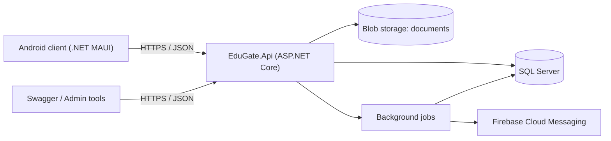
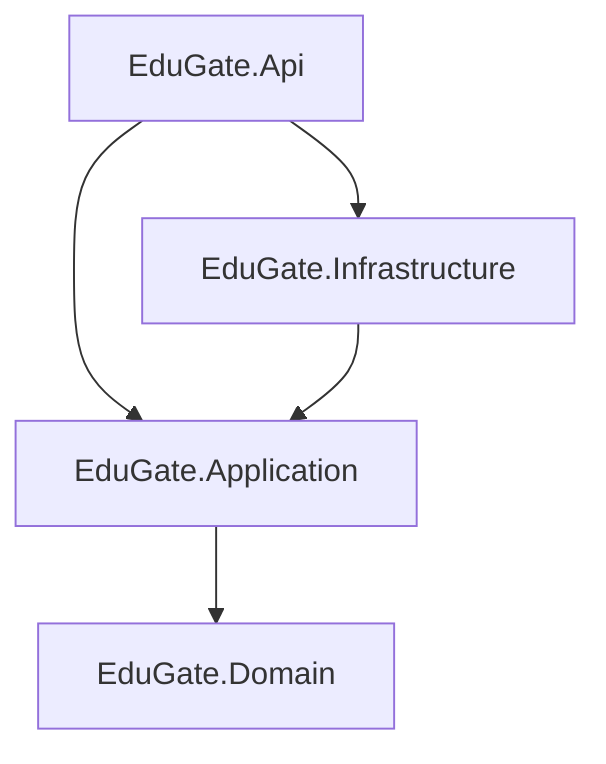
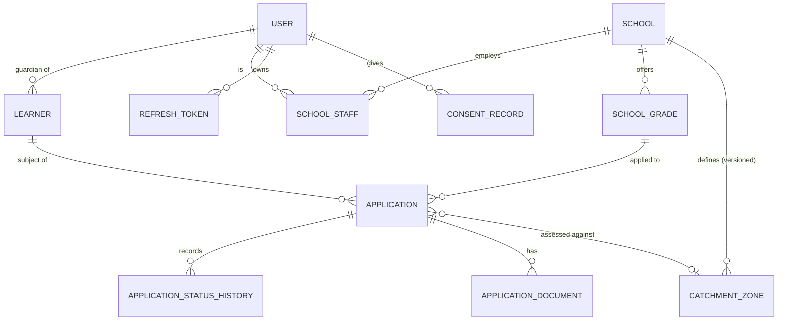
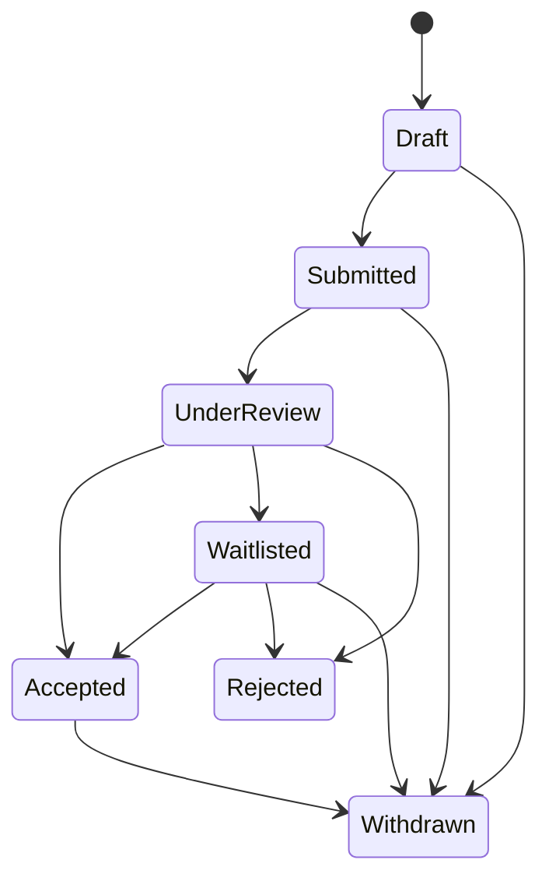

# EduGate

> Location-based school discovery and online registration for South Africa.

**Status:** 🚧 In development. Sections marked *(planned)* are designed but not yet built. This README is the source of truth for the design; if the code disagrees, one of them is a bug.

---

## 1. Problem

Parents and learners searching for schools deal with a fragmented process: visiting school websites one by one, submitting paper applications, and having no visibility into what happened afterwards.

EduGate consolidates three things into one system:

1. **Discovery:** find schools near you.
2. **Application:** apply digitally with a structured, consistent form.
3. **Tracking:** see where each application stands.

## 2. Users and roles

| Role | Who | Can do |
|---|---|---|
| **Applicant** | Learner or parent/guardian (the account holder) | Discover schools, create learner profiles, submit and track applications, upload documents |
| **School** | School admissions staff | Manage their own school profile, review and decide on **their own** applications |
| **Administrator** | Platform operator | Manage schools, verify school accounts, oversee users, view audit logs |

**Design note:** Most applicants are minors, so the account holder is usually a guardian. The model separates `User` (who logs in) from `Learner` (who is being applied for). See POPIA, section 9.

## 3. Scope 

**In scope (v1)**
- Authentication and role-based authorization
- School profiles with geolocation
- **Catchment (feeder zone) management:** schools define versioned geographic zones, approved by an administrator
- Location-based search with filters and paging, flagging schools whose catchment contains the user
- **Catchment assessment** at submission, with school verification of proof of residence
- Application lifecycle (state machine)
- Document upload
- Status-change notifications
- Admin endpoints
- Android client

**Out of scope (v1)**
- Other admission criteria (siblings, alumni, feeder-school linkage, work address)
- Automated placement or allocation (final decisions remain with schools and the department)
- Payments, web admin dashboard, iOS client, integration with provincial admission systems

## 4. System context



## 5. Architecture 

```
src/
├── EduGate.Domain           # Entities, value objects, domain rules, state machine. No dependencies.
├── EduGate.Application      # Use cases (CQRS handlers), validators, interfaces. Depends on Domain.
├── EduGate.Infrastructure   # EF Core, Identity, blob storage, notifications. Depends on Application.
└── EduGate.Api              # Controllers/endpoints, middleware, DI composition root.
tests/
├── EduGate.Domain.Tests         # Pure unit tests (state machine, invariants)
├── EduGate.Application.Tests    # Handler tests with mocked ports
└── EduGate.Api.IntegrationTests # Real SQL Server via Testcontainers
```



**Rule:** `Application` never references `Infrastructure`. `Domain` has exactly one external dependency, **NetTopologySuite**, for geometry types. It contains no spatial *logic*: spatial evaluation is a port (`ICatchmentEvaluator`) implemented in Infrastructure against SQL Server, so discovery and assessment use the same engine.

## 6. Technology choices

| Concern | Choice | Why |
|---|---|---|
| Runtime | .NET 8 (LTS) | Stable, widely used in enterprise |
| API | ASP.NET Core Web API | Industry-standard .NET backend |
| Database | SQL Server | Dominant in SA enterprise; native `geography` type |
| ORM | EF Core + NetTopologySuite | Spatial queries via `IsWithinDistance` |
| Auth | ASP.NET Identity + JWT + refresh tokens | Standard, with rotation and reuse detection |
| Use cases | MediatR (CQRS) | One handler per use case, testable in isolation |
| Validation | FluentValidation | Validation separated from domain logic |
| Errors | ProblemDetails (RFC 7807) | Consistent error contract |
| Logging | Serilog | Structured logs |
| Tests | xUnit, FluentAssertions, Testcontainers | Real DB in integration tests |
| Jobs | Hangfire *(planned)* | Notifications and retention cleanup |
| Client | .NET MAUI (Android) *(planned)* | Same language end to end |
| CI/CD | GitHub Actions, Docker *(planned)* | Build, test, and image on every PR |

## 7. Domain model



| Entity | Notes |
|---|---|
| `User` | Identity account. Role: Applicant, School, Administrator |
| `Learner` | Child or student being applied for. Owned by a guardian `User` |
| `School` | Profile, contact details, `Location` (geography point), verification status |
| `SchoolGrade` | A grade a school offers, with capacity and a `RowVersion` for concurrency |
| `SchoolStaff` | Links a School-role `User` to exactly one `School` (tenant boundary) |
| `Application` | Learner → SchoolGrade. Current status and submission data |
| `ApplicationStatusHistory` | Append-only. Every transition: from, to, actor, timestamp, reason |
| `ApplicationDocument` | Metadata for uploaded files (ID copy, report card). File lives in blob storage |
| `RefreshToken` | Hashed token, family id, used/revoked flags (reuse detection) |
| `ConsentRecord` | What was consented to, by whom, when, which policy version |
| `CatchmentZone` | `MultiPolygon` boundary (geography, SRID 4326), `Version`, `Status` (Draft, PendingApproval, Active, Retired), approver. At most one Active zone per school (filtered unique index) |
| `Learner.Residence` | Owned value: address text, `Point` location, set by the guardian |
| `Application.Assessment` | Immutable snapshot: `Result` (InCatchment, OutOfCatchment, NoZoneDefined), `ZoneId`, `AssessedAt` |
| `Application.ResidenceProof` | Pending, Verified, Rejected. Set by school staff after reviewing the proof-of-residence document |


**Priority rule:** an application has catchment priority only when `Assessment.Result == InCatchment` **and** `ResidenceProof == Verified`.

## 8. Key design decisions

**8.1 Application status is a state machine, enforced in the domain.**
Invalid transitions are impossible, not merely validated at the API.



Every transition writes an immutable row to `ApplicationStatusHistory` in the same transaction as the status change.

**8.2 Capacity is protected with optimistic concurrency.**
`SchoolGrade` carries a `rowversion` column. Two staff members accepting the last seat simultaneously cannot both succeed; the loser gets a `409 Conflict` and retries against fresh state.

**8.3 Location search uses SQL Server spatial types, not hand-rolled math.**
`School.Location` is a `geography` point with a spatial index. Search returns schools within the radius **or** whose active catchment contains the user's point, each flagged `inCatchment`, ordered in-catchment first, then by distance. The search coordinates are never persisted.


**8.4 Tenant isolation is enforced by resource-based authorization, not just roles.**
A `School` user can only access applications where `Application.SchoolGrade.SchoolId == currentUser.SchoolId`. Cross-school access returns `404`, not `403`, so resource existence is not leaked. This is covered by dedicated integration tests.

**8.5 Refresh-token rotation with reuse detection.**
Each refresh issues a new token and marks the old one used. Presenting an already-used token revokes the entire token family.

**8.6 CQRS via MediatR.**
Each use case is a command or query with its own handler and validator. Controllers stay thin and contain no business logic.

**8.7 Catchments are versioned, approved, and snapshotted.**
- A zone is immutable once Active. Editing creates a new Draft version.
- A school submits a zone; an administrator approves it. Approval retires the previous version atomically. A filtered unique index guarantees one Active zone per school.
- Boundaries are validated on input: valid geometry (no self-intersection), inside South African bounds (catches swapped lat/lng), ring orientation normalised for SQL Server `geography`.
- At submission, `ICatchmentEvaluator` assesses the learner's residence against the school's Active zone. The result and zone id are stored on the application and never recomputed.
- Self-declared residence carries no priority until school staff verify proof of residence.

## 9. Security and POPIA

EduGate stores personal information about **minors**. Compliance is a design requirement, not an afterthought.

- **Consent:** explicit guardian consent captured and versioned in `ConsentRecord` before any learner data is stored.
- **Minimisation:** collect only what a school needs to assess an application.
- **Access control:** schools see only their own applicants; every read of a learner's documents is audit-logged.
- **Retention:** application data and documents are deleted or anonymised after a defined retention period *(planned: background job)*.
- **Data subject rights:** guardians can export and delete their learners' data *(planned)*.
- **Storage:** documents in private blob storage, accessed via short-lived signed URLs; never publicly addressable.
- **Transport and secrets:** HTTPS only; secrets via environment or a vault, never committed.
- **Residential address of a minor is high-risk data.** Stored only on the learner profile, visible only to schools the learner has applied to, and every read is audit-logged.
- **Search is stateless.** Coordinates supplied to `GET /schools` are used for the query and never stored or logged.
- **Proof of residence** is a document: private blob storage, signed URLs, access-logged.

## 10. API overview 

| Area | Endpoints |
|---|---|
| Auth | `POST /auth/register`, `/auth/login`, `/auth/refresh`, `/auth/logout` |
| Schools | `GET /schools?lat=&lng=&radiusKm=&grade=&page=`, `GET /schools/{id}`, `PUT /schools/{id}` |
| Learners | `POST /learners`, `GET /learners`, `PUT /learners/{id}` |
| Applications | `POST /applications`, `GET /applications/{id}`, `POST /applications/{id}/submit`, `POST /applications/{id}/withdraw` |
| School review | `GET /school/applications`, `POST /school/applications/{id}/review`, `/accept`, `/waitlist`, `/reject` |
| Documents | `POST /applications/{id}/documents`, `GET /applications/{id}/documents/{docId}` |
| Admin | `GET /admin/users`, `POST /admin/schools/{id}/verify`, `GET /admin/audit-logs` |
| Schools | `GET /schools?lat=&lng=&radiusKm=&grade=&page=` returns `distanceKm` and `inCatchment` per school |
| Learners | `PUT /learners/{id}/residence` (address, lat, lng) |
| Catchment (school) | `PUT /school/catchment` (GeoJSON, creates Draft), `POST /school/catchment/{id}/submit` |
| Catchment (admin) | `POST /admin/catchments/{id}/approve`, `POST /admin/catchments/{id}/reject` |
| School review | `GET /school/applications?priority=`, `POST /school/applications/{id}/residence/verify`, `/residence/reject` |

All errors return `ProblemDetails`. All list endpoints are paged.

## 11. Testing strategy

- **Domain tests:** every valid and invalid state transition; capacity invariants.
- **Application tests:** handlers with mocked ports.
- **Integration tests:** full HTTP pipeline against a real SQL Server container, including auth, tenant isolation, spatial search, and concurrent-accept scenarios.
- **CI gate:** build, test, and format check must pass before merge.
- Point inside, outside, and on the boundary (document the behaviour)
- Swapped lat/lng rejected; clockwise ring corrected; self-intersecting polygon rejected
- Redrawing a zone does not change existing application assessments
- School A cannot read or modify school B's zone
- Two concurrent approvals produce exactly one Active zone
- Priority requires both InCatchment and Verified residence


## 12. Running locally 

```bash
# prerequisites: .NET 8 SDK, Docker
docker compose up -d        # SQL Server
dotnet ef database update --project src/EduGate.Infrastructure --startup-project src/EduGate.Api
dotnet run --project src/EduGate.Api
```

## 13. Roadmap

- [ ] Solution scaffold and CI
- [ ] Identity, JWT, refresh-token rotation
- [ ] School and grade management
- [ ] Catchment zones: versioning, validation, approval workflow
- [ ] Catchment assessment at submission and residence verification
- [ ] Learner profiles and consent
- [ ] Application state machine and history
- [ ] Location search (spatial index)
- [ ] Capacity and concurrency control
- [ ] Document uploads
- [ ] Notifications (background jobs)
- [ ] Audit logging and retention
- [ ] MAUI Android client
- [ ] Azure deployment
- [ ] Blazor admin dashboard

## 14. Author

Andile Mhlanga, Johannesburg, South Africa
[GitHub](https://github.com/andile593) · [LinkedIn](https://www.linkedin.com/in/andile-mhlanga-370985316/)